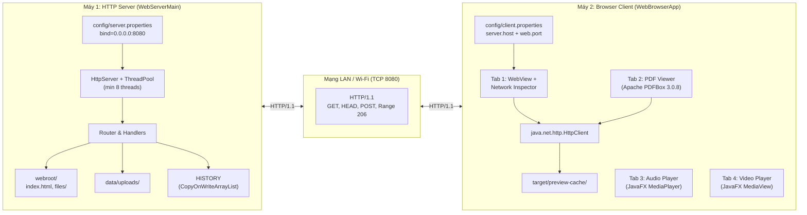
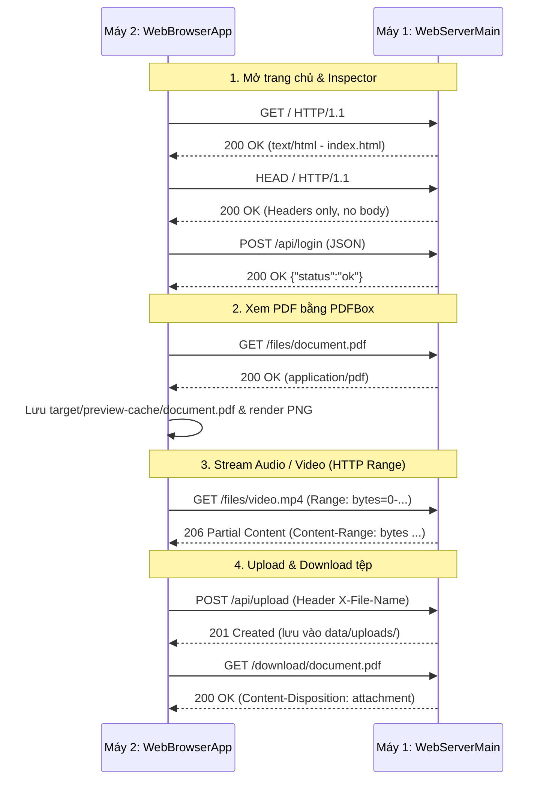

# Kiến trúc hệ thống — Lab 4: LTM Explorer (HTTP Server & JavaFX Browser)

## 1. Tổng quan

Hệ thống được thiết kế theo mô hình **Client–Server** giao tiếp qua giao thức **HTTP/1.1** trên mạng LAN (mặc định cổng TCP `8080`):

- **Máy 1 (HTTP Server — `WebServerMain`)**: Sử dụng `com.sun.net.httpserver.HttpServer` tích hợp sẵn trong JDK 21 (không cần thư viện ngoài), phục vụ trang HTML tĩnh, tài nguyên đa phương tiện (`PDF`, `MP3`, `MP4`, `TXT`), hỗ trợ `HTTP Range` (`206 Partial Content`), tải file (`Content-Disposition: attachment`) và các API kiểm thử (`GET`, `HEAD`, `POST`).
- **Máy 2 (Browser Client — `WebBrowserApp`)**: Ứng dụng desktop viết bằng **JavaFX 21** kết hợp `WebView`, `java.net.http.HttpClient`, **Apache PDFBox 3.0.8** (render PDF sang ảnh) và **JavaFX Media** (`MediaPlayer` / `MediaView` để stream audio/video).

---

## 2. Sơ đồ kiến trúc tổng thể



---

## 3. Kiến trúc phía Server (`vn.ltm.web.server.WebServerMain`)

### 3.1. Khởi tạo và mô hình đa luồng
- Đọc cấu hình từ `config/server.properties`:
  - `web.bind` (mặc định `0.0.0.0`): lắng nghe trên mọi network interface để nhận kết nối từ máy khác trong LAN.
  - `web.port` (mặc định `8080`): cổng TCP HTTP.
  - `web.root` (mặc định `webroot`): thư mục gốc chứa website và tài nguyên tĩnh.
  - `web.uploads` (mặc định `data/uploads`): thư mục lưu file client upload lên.
- Sử dụng `Executors.newFixedThreadPool(Math.max(8, availableProcessors * 2))` để xử lý đồng thời nhiều request từ Client.
- Đăng ký `ShutdownHook` (`server.stop(1)`) để đóng server an toàn khi thoát.

### 3.2. Bảng định tuyến (Routing & Endpoints)

| Method | Endpoint | Handler | Mô tả & Mã trạng thái |
|---|---|---|---|
| `GET`, `HEAD` | `/` hoặc `/home` | `serveFile` | Phục vụ `webroot/index.html` (`200 OK`) |
| `GET`, `HEAD` | `/files/{filename}` | `serveFile` | Phục vụ tài nguyên tĩnh, hỗ trợ `Range` (`200` / `206` / `404` / `416`) |
| `GET`, `HEAD` | `/download/{filename}` | `handleDownload` | Tải file từ `webroot/files/` kèm `Content-Disposition: attachment` |
| `POST` | `/api/login` | `handleLogin` | Kiểm tra payload JSON demo chứa `"student"` & `"password"` (`200` / `401`) |
| `POST` | `/api/upload` | `handleUpload` | Nhận raw body (tối đa `50 MB`), lấy tên file từ header `X-File-Name`, lưu vào `data/uploads/` (`201 Created`) |
| `GET`, `HEAD` | `/api/history` | `handleHistory` | Trả tối đa 50 request gần nhất dưới dạng JSON array (`200 OK`) |

### 3.3. Hỗ trợ HTTP Range Streaming (`206 Partial Content`)
Trong `serveFile(...)`, Server kiểm tra header `Range: bytes=...`:
- Hỗ trợ dạng `bytes=start-end`, `bytes=start-` và suffix range `bytes=-suffixLength`.
- Nếu hợp lệ: trả mã `206 Partial Content`, header `Content-Range: bytes start-end/size`, `Accept-Ranges: bytes`, và chỉ đọc/gửi đúng phần byte yêu cầu (`input.skipNBytes(start)`).
- Nếu không hợp lệ: trả mã `416 Range Not Satisfiable` kèm `Content-Range: bytes */size`.
- Với method `HEAD`: chỉ trả headers (`Content-Type`, `Content-Length`, `Accept-Ranges`, `Content-Disposition` nếu download), không gửi body.

### 3.4. Bảo mật và kiểm soát hợp lệ
- **Chống Path Traversal**: chuẩn hóa đường dẫn bằng `.toAbsolutePath().normalize()` và kiểm tra `startsWith(webRoot)` / `startsWith(uploadRoot)` / `startsWith(filesRoot)`; nếu vượt ra ngoài thư mục cho phép trả `403 Forbidden` hoặc `400 Bad Request`.
- **Làm sạch tên file (`sanitizeName`)**: loại bỏ dấu `/` và `\`, thay ký tự đặc biệt ngoài `[A-Za-z0-9._ -]` bằng `_`.
- **Giới hạn dung lượng**: `readLimited(...)` giới hạn upload tối đa `50 MB` (`MAX_UPLOAD_BYTES`) và `/api/login` tối đa `1 MB`.
- **Header an toàn**: gắn `X-Content-Type-Options: nosniff` cho phản hồi file.

### 3.5. MIME Types được hỗ trợ
`.html` (`text/html; charset=utf-8`), `.css` (`text/css; charset=utf-8`), `.js` (`text/javascript; charset=utf-8`), `.pdf` (`application/pdf`), `.mp3` (`audio/mpeg`), `.mp4` (`video/mp4`), `.png` (`image/png`), `.jpg`/`.jpeg` (`image/jpeg`), `.txt` (`text/plain; charset=utf-8`), mặc định `application/octet-stream`.

---

## 4. Kiến trúc phía Client (`vn.ltm.web.client.WebBrowserApp`)

### 4.1. Cấu hình và thành phần giao diện
- Khi khởi động, `loadConfig()` đọc `config/client.properties` (`server.host`, `web.port`) để tạo URL gốc `base = "http://" + host + ":" + port`.
- Giao diện chính dùng stylesheet `src/main/resources/styles/app.css` với thanh điều hướng (`←`, `→`, `↻`, `⌂`, thanh địa chỉ, nút `PDF`, `MP3`, `MP4`, menu `↓ Tải tệp`) và 4 tab:

1. **Tab `Web Browser`**:
   - Dùng `javafx.scene.web.WebView` và `WebEngine` để hiển thị trang HTML từ Server.
   - **Network Inspector** bên phải: dùng `java.net.http.HttpClient` (connect timeout 8s) gửi `GET`, `HEAD`, `POST` (`/api/login`) và `POST` upload file (`/api/upload` với header `X-File-Name`), hiển thị Status, Response Headers và Body Preview; đồng thời lưu lịch sử URL đã truy cập.
2. **Tab `PDF Viewer`**:
   - Tải `/files/document.pdf` về cache cục bộ `target/preview-cache/document.pdf`.
   - Dùng **Apache PDFBox 3.0.8** (`Loader.loadPDF`, `PDFRenderer.renderImageWithDPI(index, 110)`) render bất đồng bộ từng trang ra file PNG trong `target/preview-cache/` và hiển thị trên `ImageView` kèm điều hướng trang trước/tiếp.
3. **Tab `Audio Player`**:
   - Khởi tạo `javafx.scene.media.Media("http://<host>:<port>/files/music.mp3")` và `MediaPlayer`.
   - Hỗ trợ Play / Pause / Stop, thanh trượt tiến trình (seek), hiển thị thời lượng `mm:ss` và nút tải về.
4. **Tab `Video Player`**:
   - Khởi tạo `Media("http://<host>:<port>/files/video.mp4")`, `MediaPlayer` và `MediaView`.
   - JavaFX Media tự động gửi HTTP Range requests tới Server để stream và tua video.

---

## 5. Luồng tương tác giữa 2 máy (Sequence Diagram)



---

## 6. Cấu trúc thư mục chuẩn hóa

```text
Lab4-Web/
├── config/
│   ├── client.properties          # IP và port Server cho Máy 2 (Client)
│   └── server.properties          # Bind address, port, thư mục webroot & uploads cho Máy 1
├── docs/
│   ├── ARCHITECTURE.md            # Tài liệu kiến trúc hệ thống (file này)
│   ├── SETUP-2-MACHINES.md        # Hướng dẫn chi tiết kết nối 2 máy qua LAN
│   └── LOCAL-VERIFICATION.md      # Biên bản kiểm thử cục bộ
├── scripts/
│   ├── build.bat                  # Build toàn bộ project bằng Maven
│   ├── check-connection.bat       # Kiểm tra kết nối TCP & HTTP từ Client sang Server
│   ├── check-web.ps1              # Script PowerShell kiểm tra các endpoint HTTP
│   ├── open-firewall.bat          # Mở cổng TCP 8080 trên Windows Firewall (Admin)
│   ├── run-client.bat             # Khởi động JavaFX Browser Client (Máy 2)
│   ├── run-server.bat             # Khởi động HTTP Server (Máy 1, tự fallback javac nếu thiếu Maven)
│   └── setup-client.bat           # Nhập IP Máy 1 và cập nhật config/client.properties
├── src/main/
│   ├── java/vn/ltm/web/
│   │   ├── client/WebBrowserApp.java
│   │   └── server/WebServerMain.java
│   └── resources/styles/app.css
├── webroot/
│   ├── index.html
│   └── files/
│       ├── document.pdf
│       ├── music.mp3
│       ├── sample.txt
│       └── video.mp4
├── .gitignore
├── pom.xml
└── README.md
```
